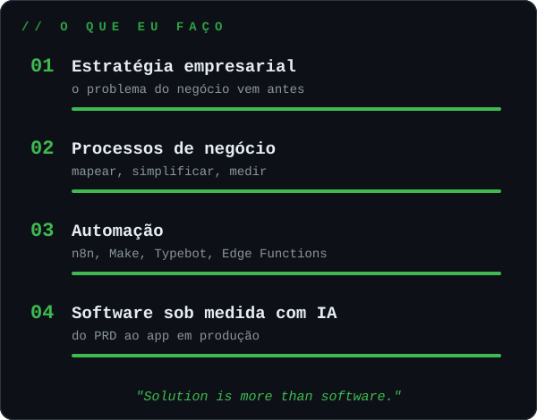
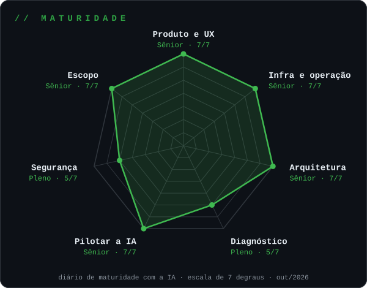
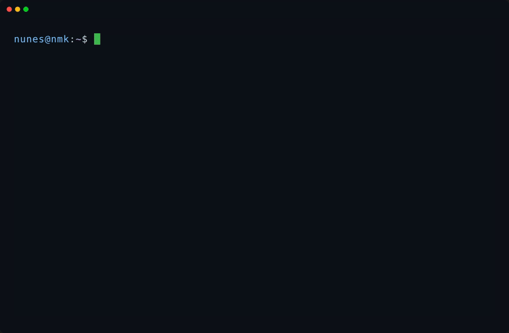
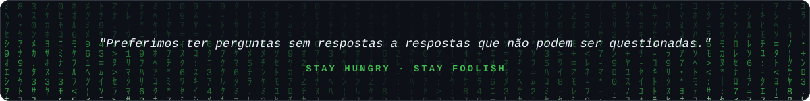

<picture>
  <source media="(prefers-color-scheme: dark)" srcset="assets/header-dark.svg"/>
  <source media="(prefers-color-scheme: light)" srcset="assets/header-light.svg"/>
  
</picture>

<h6>
  <a href="#-quem-sou">Quem sou</a>
  ·
  <a href="#-nmk-em-um-terminal">NMK em um terminal</a>
  ·
  <a href="#-trajetória">Trajetória</a>
  ·
  <a href="#-arsenal">Arsenal</a>
  ·
  <a href="#-contribuições">Contribuições</a>
</h6>

<em>Estratégia, processos, automação e software sob medida com IA, para pequenas e médias empresas em Portugal e no Brasil.</em>

---

## 🟢 Quem sou

<picture>
  <source media="(prefers-color-scheme: dark)" srcset="assets/whoami-dark.svg"/>
  <source media="(prefers-color-scheme: light)" srcset="assets/whoami-light.svg"/>
  
</picture>

 

<picture>
  <source media="(prefers-color-scheme: dark)" srcset="assets/pilares-dark.svg"/>
  <source media="(prefers-color-scheme: light)" srcset="assets/pilares-light.svg"/>
  
</picture>
<picture>
  <source media="(prefers-color-scheme: dark)" srcset="assets/maturidade-dark.svg"/>
  <source media="(prefers-color-scheme: light)" srcset="assets/maturidade-light.svg"/>
  
</picture>

## 💊 NMK em um terminal

  
  
Não é montagem: é um script de verdade (<a href="demo/nmk">fonte</a>), feito com <a href="https://github.com/charmbracelet/gum">gum</a> e gravado com <a href="https://github.com/charmbracelet/vhs">VHS</a> (<a href="demo/demo.tape">roteiro</a>).

## 🛤 Trajetória

<picture>
  <source media="(prefers-color-scheme: dark)" srcset="assets/trajetoria-dark.svg"/>
  <source media="(prefers-color-scheme: light)" srcset="assets/trajetoria-light.svg"/>
  
</picture>

## 🥋 Arsenal

Eu não escrevo código: eu conduzo produtos com IA, da reunião com o cliente ao app em produção.

**Inteligência artificial**

**Backend, deploy e infraestrutura**

**Automação e operação**

## ⚡ Fun facts

- **Já fui menor infrator.** Comecei aos 13 anos, copiando disquetes, embalando computadores e ensinando clientes a ligar um **Amiga** (depois veio o ZX Spectrum). Era a época da reserva de mercado, e trazer computador de fora para vender no Brasil era crime. Eu não sabia.
- **O H do Renatho é estratégia de SEO.** Quando eu dava aulas de SEO, havia quatro "Renato Siqueira" mais famosos do que eu no Google. Passei a assinar Renatho, com H, e no Google só aparecia eu. O pseudônimo virou nome de registro.

## 🐍 Contribuições

<picture>
  <source media="(prefers-color-scheme: dark)" srcset="https://raw.githubusercontent.com/SolluSaaS/SolluSaaS/output/snake-dark.svg"/>
  <source media="(prefers-color-scheme: light)" srcset="https://raw.githubusercontent.com/SolluSaaS/SolluSaaS/output/snake.svg"/>
  
</picture>

  

<picture>
  <source media="(prefers-color-scheme: dark)" srcset="assets/footer-dark.svg"/>
  <source media="(prefers-color-scheme: light)" srcset="assets/footer-light.svg"/>
  
</picture>
